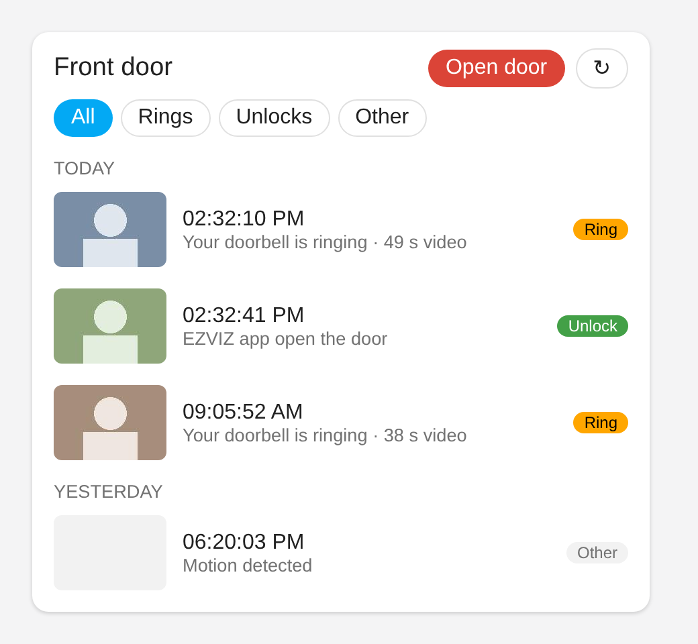

<h1 align="center">EZVIZ HP7 / CP7 Video Intercom<br><sub>for Home Assistant</sub></h1>

<p align="center">
  <b>Someone rings: you see who it is within seconds, and open the door with one tap, without answering the call.</b>
</p>

<p align="center">
  <a href="https://github.com/kienxux/ezviz_instant_bell/releases"></a>
  <a href="https://github.com/kienxux/ezviz_instant_bell/actions/workflows/tests.yml"></a>
  <a href="https://github.com/kienxux/ezviz_instant_bell/actions/workflows/validate.yml"></a>
  <a href="LICENSE"></a>
  <a href="https://hacs.xyz"></a>
</p>

A Home Assistant integration for the **EZVIZ HP7 and CP7 video intercoms**: the door station at your gate or door and the indoor monitor inside. It shows everything the intercom reports, lets you change its settings, and adds what makes a video intercom worth having in a smart home: a ring notification **with the picture**, an **Open door** button on your phone, the **recordings on the SD card**, and the **live video**, in Home Assistant and for Frigate or go2rtc.

> Independent project. Not affiliated with or endorsed by EZVIZ or Hikvision.

## Highlights

- **Instant ring picture.** An event and the picture of the visitor arrive in about 5 to 12 seconds, most of which is EZVIZ's own delay.
- **Open the door from the notification.** A ready-made blueprint sends the picture to every phone with an **Open door** button. The door only opens when someone taps it for that ring.
- **Visitor log card.** One dashboard card with the rings and unlocks of the last days, their pictures and their SD-card videos, and an Open door button.
- **Recordings of the SD card.** Browse and play what the door station recorded, by day, in the Media browser. No EZVIZ cloud plan needed.
- **Live video.** Cloud or directly from your network, with sound in the Home Assistant stream mode, also when the door station encrypts it. The local live video keeps working when the EZVIZ cloud is down.
- **Frigate and go2rtc.** Home Assistant hands the live video to other apps through an address with a token.
- **Motion and person events.** As event types of the Doorbell entity, and their pictures saved in the media folder if you want.
- **Everything the intercom reports.** Sensors, switches, chime volume and ringtones for the door station and every indoor monitor, and who unlocked the door (app, card, face, palm or code).
- **Safe by design.** Opening the door is always a deliberate action. A failed unlock never tries a different lock.

## Contents

- [Which devices](#which-devices)
- [Install and set up](#install-and-set-up)
- [What you get](#what-you-get)
- [Rings and notifications](#rings-and-notifications)
- [Visitor log card](#visitor-log-card)
- [Recordings and pictures](#recordings-and-pictures)
- [Live video](#live-video)
- [Frigate and go2rtc](#frigate-and-go2rtc)
- [When the EZVIZ cloud is down](#when-the-ezviz-cloud-is-down)
- [Events and actions for automations](#events-and-actions-for-automations)
- [Options](#options)
- [Troubleshooting](#troubleshooting)
- [Privacy and security](#privacy-and-security)
- [Roadmap and contributing](#roadmap-and-contributing)
- [Credits and licence](#credits-and-licence)

## Which devices

| | |
| --- | --- |
| **Made for** | EZVIZ video intercoms of the **HP7 and CP7 family**: a door station with an indoor monitor |
| **Checked on real hardware** | CS-CPD5 door station with CS-CP5 monitor (EU account) |
| **Other EZVIZ devices** | Cameras and doorbells of the same account can be chosen too. They get what every EZVIZ device reports: events, pictures, SD-card recordings and the cloud live video. The unlock buttons and the chime and name-tag light controls are only made for an HP7 / CP7 door station (EZVIZ category `BDoorBell`, or `DBScreen` where the account lists the HP7 only as its monitor). **Not tested on real hardware**: please report what works |
| **Not for** | EZVIZ smart locks, and cameras you mainly want to control (pan and tilt, sirens, lights): Home Assistant's own EZVIZ integration covers those |

The reading of the device's data is tested against an anonymised copy of a real device's answers. Door and gate buttons, chime sliders and switches use the documented EZVIZ calls; the live video is ported from open-source work (see [Credits](#credits-and-licence)). If something does not work on your model, please [open an issue](https://github.com/kienxux/ezviz_instant_bell/issues/new/choose) and attach the diagnostics download (see [Troubleshooting](#troubleshooting)).

## Install and set up

### Install with HACS

1. Open HACS, search for **EZVIZ HP7 / CP7 Video Intercom** and open it. It is listed in the HACS default store, so no custom repository is needed.
2. Install it and restart Home Assistant.

If the search finds nothing: HACS refreshes its store list every few hours, and your HACS keeps its copy for a while longer. Restart Home Assistant to make HACS fetch the list again, or add the repository by hand meanwhile (three-dot menu > **Custom repositories** > `https://github.com/kienxux/ezviz_instant_bell`, type **Integration**). Both lead to the same integration and updates.

### Set up

1. **Settings > Devices & services > Add integration > EZVIZ HP7 / CP7 Video Intercom**.
2. Log in with your EZVIZ account (and the verification code if EZVIZ sends one), then choose the door station. For an HP7 or CP7 it is the entry marked `BDoorBell`; if the account has none, the one marked `DBScreen`. The indoor monitor is found automatically.

Logging in registers one new terminal named `Hassio` in your EZVIZ account. EZVIZ allows 10 terminals per account; the integration keeps a stable ID so that restarts and Docker do not fill the slots, and warns you before the limit is reached.

To change the login, the region or the chosen door stations later, use **Reconfigure** in the three-dot menu of the integration. Everything else is in the [options](#options).

### First check

- Press **Unlock Door** while you stand at the door and check that the door opens (and not the gate). If it is the gate, swap the lock numbers in the options. A failed call shows an error and never tries the other lock.
- Change the **Monitor volume** slider and see that the monitor follows.
- Toggle **Do Not Disturb** and **Privacy** and see them change in the EZVIZ app.
- Open the **Live** camera. If it stays black, set the source to `local` or `cloud` and look for "StreamRelay" lines in the log.

## What you get

| Kind | Entities |
| --- | --- |
| **Instant bell** | `Doorbell` (event: `ring`, `door_unlock`, `gate_open`, `motion`, `person`, `other`) and `Last picture` (image), both within seconds |
| **Open** | Buttons `Unlock Door` and `Unlock Gate`, and the actions `ezviz_instant_bell.unlock_door` / `unlock_gate` |
| **Sensors** | Name, firmware, online status, WiFi signal, SSID, local and WAN IP, motion, last alarm and its type, seconds since last motion, update available, microphone volume |
| **Binary sensors** | Motion; short pulses (3 s) for doorbell ringing, gate open, lock unlocked and app unlock. Card, face, palm and code unlock and the smart and intelligent detection alarms depend on the model, so each appears the first time the door station reports one. Read-only states of mute, loitering, stranger and human detection, when the device reports them |
| **Switches** | Doorbell chime and motion sound alert (door station and indoor monitor), do not disturb, privacy, armed, name-tag light, doorbell indicator (the light at the call button, when the door station has one) |
| **Sliders** | Chime volume (0 to 7) and ringtones for the doorbell and the motion alert, on the door station and on every indoor monitor |
| **Camera** | `Live`: the live video (cloud or local network). `Last Snapshot`: the picture of the latest alarm |
| **Media** | *Recordings (SD card)* and *Pictures of events* in the Media browser |
| **Dashboard** | The visitor log card |
| **Account** | `Terminals in use`, and a repair notice before EZVIZ's 10-terminal limit is reached |

Other EZVIZ cameras and doorbells get no unlock buttons, chime controls, name-tag light or doorbell indicator (see [Which devices](#which-devices)). The events and actions for automations are listed in [Events and actions for automations](#events-and-actions-for-automations).

## Rings and notifications

### How the instant bell works

- **Unlock and gate events** arrive by EZVIZ push within seconds.
- **Rings** are not pushed on these devices. The integration asks EZVIZ for new entries in your message list every 5 seconds (adjustable, minimum 2). The EZVIZ app has the same delay.
- **Status** (sensors, switches, sliders) is read every 15 seconds, and straight away after a ring or unlock. A short cloud outage keeps the last values; a longer one makes the entities unavailable and tries a new login once.

### Notification with an Open door button

Import the blueprint, then create an automation from it:

[](https://my.home-assistant.io/redirect/blueprint_import/?blueprint_url=https%3A%2F%2Fgithub.com%2Fkienxux%2Fezviz_instant_bell%2Fblob%2Fmain%2Fblueprints%2Fautomation%2Fezviz_instant_bell%2Fring_notification.yaml)

Choose the doorbell event, the picture, the **Unlock Door** button and the notification service of each phone (for example `notify.mobile_app_my_phone`; add one entry per phone, and whoever taps **Open door** first opens it). It works with the Home Assistant companion app on Android and iPhone. The door opens only if you tap the button for that ring, within a time limit you set. Nothing opens by itself.

### More notification blueprints

Two variants of the ring blueprint, for when a phone notification is not enough. Neither opens the door.

- **Persistent notification.** Shows the ring with its picture as a notification in Home Assistant, so it stays visible until you dismiss it (or until the time you set), even if you miss the phone notification.

  [](https://my.home-assistant.io/redirect/blueprint_import/?blueprint_url=https%3A%2F%2Fgithub.com%2Fkienxux%2Fezviz_instant_bell%2Fblob%2Fmain%2Fblueprints%2Fautomation%2Fezviz_instant_bell%2Fring_persistent_notification.yaml)

- **Speaker announcement.** A speaker announces the ring out loud, for example "Someone is at the door". Pick the speaker, a text-to-speech entity (its voice and language are used) and the words to say; you can also have it set the speaker volume first.

  [](https://my.home-assistant.io/redirect/blueprint_import/?blueprint_url=https%3A%2F%2Fgithub.com%2Fkienxux%2Fezviz_instant_bell%2Fblob%2Fmain%2Fblueprints%2Fautomation%2Fezviz_instant_bell%2Fring_speaker_announcement.yaml)

### Motion and person as events

Switch on **Motion as an event of the Doorbell entity** and/or **Person as an event of the Doorbell entity** in the options (both off by default). The **Doorbell** event entity then also fires `motion` or `person`, with the message's text in `message`, so an automation can trigger on them like on a ring.

- They come through the same message check as the rings, a few seconds after the door station reports them. Each check reads the newest 5 entries.
- Motion and person are told apart by the name of the message (for example *Motion Detection Alarm*, *Human detected*, *Smart Detection Alarm*) and by its code. A message that is recognised as neither stays `other`, as before. The codes of the latest messages are in the diagnostics download (`recent_messages`); please attach it to an issue if your door station's messages land in the wrong type.
- Their picture does not replace the **Last picture** of a ring. To keep it, see [Save the pictures of motion and people](#save-the-pictures-of-motion-and-people).
- Which events the door station reports is set in the EZVIZ app.

## Visitor log card

<p align="center"><br><sub>The card with sample data</sub></p>

A dashboard card that lists the rings, unlocks and other events of the last days, newest first, each with its picture and, when the door station recorded it, the video from the SD card. Tap a row to see the picture or play the video; the chips filter by kind.

The integration adds the card by itself: it puts `/ezviz_instant_bell_static/ezviz-visitor-log-card.js` into *Settings > Dashboards > Resources*, keeps its version up to date and takes it out again when you remove the integration (reload the browser once after installing). If your resources are kept in YAML, it loads the card without touching them; a browser that stays open while Home Assistant restarts then needs a reload.

Add it with *Edit dashboard > Add card > EZVIZ visitor log*, or in YAML:

```yaml
type: custom:ezviz-visitor-log-card
title: Front door            # optional
serial: BE0000001-BE0000002  # optional; all door stations when left out
days: 2                      # 1 to 7, default 1
show_unlock: true            # show the open button(s), default true (asks to confirm)
unlock: door                 # door, gate or both, default door
event_entity: event.front_door_doorbell   # optional: reload the moment a ring arrives
```

The open button shows by default; set `show_unlock: false` to hide it, or `unlock: both` for a door and a gate button. With more than one door station, set `serial` so the button knows which one to open. The list refreshes every minute. Pictures and videos are served through signed links that expire after ten minutes.

## Recordings and pictures

### Recordings of the SD card

Open **Media** in the sidebar, choose **EZVIZ HP7 / CP7 Video Intercom**, your door station, **Recordings (SD card)** and a day. Each video is listed with its start time and length, newest first; the picture of the ring or motion event next to it is its thumbnail. The same list is reachable from dashboard cards and from automations (`media-source://ezviz_instant_bell/...`).

- The video is asked from the EZVIZ servers when you press play. The door station must be online and its SD card must hold the recording. No EZVIZ cloud plan is needed.
- The servers send the video at about normal speed, so a 50-second clip needs about 50 seconds to arrive. Playback starts after a few seconds and runs while the rest arrives (no skipping ahead yet). When the clip is complete it is stored as an ordinary MP4 in `<config>/.storage/ezviz_instant_bell_clips`; later views start at once and can be skipped through.
- Stored clips are removed, oldest first, when the folder is larger than 500 MB. The clips are part of a Home Assistant backup unless you exclude that folder.
- One clip is fetched at a time per account. Video encryption must be off (as for the live view without a key).
- `ffmpeg` must be available (it is part of Home Assistant OS and the Docker image).

### Save the video of every ring

Switch on **Save the video of every ring** in the options and the integration keeps the recording of each ring: after the ring it waits for the door station to finish recording, fetches the video like a played clip, and announces it with the event `ezviz_instant_bell_clip_saved` and the sensor **Last saved clip** (its attributes hold `media_content_id`, which a media player or an automation can play). It is off by default because it makes the door station send a video after every ring; it needs an SD card in the door station and video encryption off. Saved clips share the 500 MB of the clip folder.

### Pictures of events

**Media > EZVIZ HP7 / CP7 Video Intercom > your door station > Pictures of events > a day** shows every event EZVIZ kept for that day with its picture: rings, door and gate openings, motion, for the last 14 days.

- The list is what EZVIZ keeps in its message list, like the EZVIZ app.
- Pictures are fetched on demand and the last 100 are kept in memory; nothing is written to disk.
- The first view of a day takes a moment (up to 4 requests of 50 entries); the list is then kept for a minute (today) or 15 minutes (older days).

### Save the pictures of motion and people

Switch on **Save the picture of every motion and person event** in the options. The integration then stores the picture of each motion and person event in the media folder of Home Assistant. No automation is needed. Find them under **Media > My media > ezviz_instant_bell > your door station > a day**, named like `14-03-12_motion_detection_alarm.jpg`.

- The picture arrives about 5 to 12 seconds after the event, through the same message check as the rings.
- Everything the door station reports with a picture counts, except rings and door or gate openings. Rings already have the **Last picture** entity, which this option does not change.
- Which events the door station reports (motion, human detection, sensitivity, zones) is set in the EZVIZ app.
- Pictures are kept for 30 days by default (option **Keep the saved pictures for**); older day folders are deleted. Nothing outside `ezviz_instant_bell` in the media folder is touched.
- Each saved picture fires `ezviz_instant_bell_picture_saved` with `path` and `media_content_id`, should you want a notification after all.
- The folder is the `local` media folder: `/media` on Home Assistant OS and in the Docker image when it is mounted, otherwise `<config>/media`. Each check reads the newest 5 entries, so if more than 5 events happen within one check interval, the older ones are missed.

## Live video

The **Live** camera of each door station. Its settings are in the [options](#options):

- **Source**: `cloud` (EZVIZ relay, the default), `local` (straight from the door station on your network; Home Assistant must be on the same network) or `auto` (local first, then cloud).
- **Delivery to the browser**: `auto` looks at the video once and picks: H.264 uses the Home Assistant stream (sound, low delay), HEVC uses motion JPEG (every browser, no sound). `webrtc` and `mjpeg` force one of them.
- While someone watches the local stream, the status is read a quarter as often, because the door station's processor is small. A ring or unlock wakes the stream up, so the first picture is quick.

### Encrypted video

Some firmware encrypts the video and offers no switch in the EZVIZ app. EZVIZ then e-mails a 4-digit code when the live view is opened; a repair notice asks for it, or use the action `fetch_encryption_key` (with `serial` when you have more than one door station). The 6-character code on the label does not work for this. The key decrypts picture and sound with both stream sources; sound that still cannot be read is played as silence. `set_video_encryption` turns the device's encryption on or off, and only when you call it. Both actions need an administrator.

### Relay

The live video runs through a relay inside Home Assistant that listens on `127.0.0.1` only. A fixed port and `0.0.0.0` (options, section *Other apps*) still work for go2rtc or Frigate on another machine, but that socket has no password, and a repair notice says so while it is set; the [addresses with a token](#frigate-and-go2rtc) are the safer way.

## Frigate and go2rtc

Home Assistant can hand the live video to other apps, for example Frigate (detection and recording) or go2rtc, through two addresses per door station:

| Address | What it serves |
| --- | --- |
| `/api/ezviz_instant_bell/live/<serial>?token=…` | MPEG-TS with sound: the video as the relay has it (H.264, or H.265 when the door station sends it and nothing converts it) |
| `/api/ezviz_instant_bell/mjpeg/<serial>?token=…` | Motion JPEG, no sound |

1. Switch on **Let other apps read the live video (go2rtc, Frigate)** in the options (section *Other apps*) and save.
2. Open the options again. Their description shows both addresses of each door station, with the address of your Home Assistant and the token.
3. Use the MPEG-TS address in the other app, as it is, for example as below. The motion JPEG address is for apps that take only MJPEG.

go2rtc:

```yaml
streams:
  front_door:
    - "http://192.168.1.10:8123/api/ezviz_instant_bell/live/BE0000001?token=YOUR_TOKEN"
```

Frigate, through the go2rtc that comes with it:

```yaml
go2rtc:
  streams:
    front_door:
      - "http://192.168.1.10:8123/api/ezviz_instant_bell/live/BE0000001?token=YOUR_TOKEN"

cameras:
  front_door:
    ffmpeg:
      inputs:
        - path: rtsp://127.0.0.1:8554/front_door
          input_args: preset-rtsp-restream
          roles:
            - detect
            - record
```

Checked with Frigate and a real door station, and with go2rtc 1.9.15 and test streams in H.264 and H.265 with sound.

- It is off by default. **Make a new token** stops the addresses handed out so far; the new ones show the next time you open the options.
- Anyone with an address can watch, so keep it like a password. A wrong token counts as a failed login, so Home Assistant's IP ban applies. The right one never does: while Home Assistant starts or waits for the EZVIZ cloud, the app gets "503 Service Unavailable" and tries again.
- Reading an address opens the live video, like opening the **Live** camera. An app that records around the clock keeps it open all the time; with the `local` source, the status is then read a quarter as often.
- If the door station sends H.265 and a browser shows no picture, let go2rtc convert it, at the cost of processor time: `"ffmpeg:http://…/live/BE0000001?token=YOUR_TOKEN#video=h264#audio=aac"`. Keep `#audio=aac`: with `#audio=copy` the stream does not start, because ffmpeg cannot pass this sound on to RTSP unchanged.

## When the EZVIZ cloud is down

Most of this integration works through the EZVIZ cloud, like the EZVIZ app does. What it needs to show the **local live video** is kept on your Home Assistant, so that part keeps working without the cloud:

- After the integration has run once with the cloud, it stores the door station's local key and address, its model and its indoor monitors in `<config>/.storage/ezviz_instant_bell.local.<entry>`.
- If EZVIZ cannot be reached when Home Assistant starts, the integration starts anyway with the same entities. The **Live** camera plays with the stored key when its source is `local` or `auto`; the other entities show as unavailable, and a repair notice says why. A new login is tried every 5 minutes, and everything starts again by itself when EZVIZ answers.
- What still needs the cloud: rings, unlocking the door, settings, recordings and pictures. Unlocking says so instead of failing silently.
- The local live video uses the stored key and address also while the cloud is up, so it starts without waiting for EZVIZ. Only when the door station refuses them or cannot be reached there does it ask the cloud for both again (for a new address from the router, or a new key); if either changed, it tries once more at once. Until the cloud answers, a changed key or address does not work.

## Events and actions for automations

The **Doorbell** event entity fires `ring`, `door_unlock` and `gate_open`, with the options also `motion` and `person`, and `other` for a message it does not recognise. Besides, the integration fires these events:

| Event | When |
| --- | --- |
| `ezviz_instant_bell_unlock` | The door or gate was opened, with the way it was opened and the card holder's name. `ezviz_hp7_unlock` is fired as well, for automations written against the old name |
| `ezviz_instant_bell_door_opened` | Someone opened the door or gate from Home Assistant, with the user; also shown in the logbook |
| `ezviz_instant_bell_clip_saved` | The video of a ring was saved (option **Save the video of every ring**) |
| `ezviz_instant_bell_picture_saved` | The picture of a motion or person event was saved, with `path` and `media_content_id` |

Actions (`serial` is needed only when you have more than one door station):

| Action | What it does |
| --- | --- |
| `ezviz_instant_bell.unlock_door` / `unlock_gate` | Opens the door or the gate |
| `ezviz_instant_bell.take_snapshot` | Saves a picture taken now from the live video, over the LAN without the cloud, under **Media > My media**; fires `ezviz_instant_bell_picture_saved` |
| `ezviz_instant_bell.fetch_encryption_key` | Gets the key for encrypted video: without `code`, EZVIZ e-mails a 4-digit code; call it again with that code. Administrators only |
| `ezviz_instant_bell.set_video_encryption` | Turns the door station's video encryption on or off (`enable`, `verification_code`). Administrators only |

## Options

Open them with **Configure** on the integration. Saving reloads the integration, so the changes apply at once. The first four are at the top of the form, the others in sections; *Live video*, *Other apps* and *Troubleshooting* start closed.

| Option | Default | What it does |
| --- | --- | --- |
| Ring check interval (seconds) | 5 | How often the EZVIZ message list is checked for rings, 2 to 60 |
| Indoor monitor serial numbers | empty | Empty finds the monitors by itself |
| Lock number of the door / of the gate | 2 / 1 | As seen on an HP7; swap them if **Unlock Door** opens the gate |
| ***Rings, recordings and pictures*** | | |
| Save the video of every ring | off | See [Save the video of every ring](#save-the-video-of-every-ring) |
| Save the picture of every motion and person event in the media folder | off | See [Save the pictures of motion and people](#save-the-pictures-of-motion-and-people) |
| Keep the saved pictures for (days) | 30 | 1 to 365 |
| Motion / Person as an event of the Doorbell entity | off | See [Motion and person as events](#motion-and-person-as-events) |
| ***Live video*** | | |
| Source | `cloud` | `cloud`, `local` or `auto`, see [Live video](#live-video) |
| Delivery to the browser | `auto` | `auto`, `webrtc` or `mjpeg`, see [Live video](#live-video) |
| Video codec | `auto` | `auto` detects it; `h264`; `hevc` converts H.265 to H.264 for the Home Assistant stream; `hevc_copy` passes H.265 through untouched (weak hosts, Frigate, Safari) |
| Picture size of the local stream | `main` | `sub` asks the local source for the door station's small picture, which is far cheaper to decode on a weak host |
| Encryption key | empty | See [Encrypted video](#encrypted-video) |
| Open the live video at a ring for (minutes) | 0 (off) | At a ring, and at motion or a person when those events are on, the live video opens at once and stays open this long, so it shows without waiting. 0 to 30 |
| Keep the live video open all the time | off | Like Frigate: the live video stays open and shows at once. Only with the source `local`; with `cloud` or `auto` it is ignored, because the video would be uploaded all the time. Costs some CPU |
| ***Other apps (go2rtc, Frigate)*** | | |
| Let other apps read the live video (go2rtc, Frigate) | off | See [Frigate and go2rtc](#frigate-and-go2rtc) |
| Make a new token | | Stops the addresses handed out so far |
| Fixed port of the relay / Relay listen host | 0 / `127.0.0.1` | See [Relay](#relay) |
| ***Troubleshooting*** | | |
| Repeat the stream headers before every keyframe | off | Switch it on if the log shows "Immediate exit requested" |
| Write diagnostic dumps | off | Writes the start of the stream to two `.bin` files in the config folder, for a video bug report only |

## Troubleshooting

- **Download diagnostics** from *Settings > Devices & services > EZVIZ HP7 / CP7 Video Intercom > three dots* and attach the file to your issue. It contains no password, account name, serial numbers, addresses or keys.
- Switch on debug logging for `custom_components.ezviz_instant_bell` and look for "StreamRelay" (video) lines, and "Shared stream" lines for the addresses for other apps. Remove passwords, keys, tokens and serial numbers before sharing logs.
- A setup that fails with an unknown value from the device is a bug in this integration: please report it.

## Privacy and security

- Your EZVIZ login is stored by Home Assistant like for any integration. Nothing is sent anywhere except to EZVIZ (and, for the local stream, to your own door station), and the live video to the apps you give a stream address.
- Pictures are kept only in memory (the latest one, and up to 100 from the history browser), unless you switch on saving the pictures of motion and person events. Recordings you play are stored as MP4 files in the `.storage` folder, up to 500 MB.
- For the live video without the cloud, the door station's local key and address are stored in the `.storage` folder, next to the EZVIZ login that Home Assistant keeps there anyway.
- The addresses for other apps are off by default. Their token is kept in the options and hidden in the diagnostics; a wrong token counts as a failed login.
- The administrator-only actions are the ones that change video encryption or fetch its key. The door can be opened by every Home Assistant user who may press the button, so give guests a dashboard without it. Every opening from Home Assistant is recorded with the user in the logbook (event `ezviz_instant_bell_door_opened`).
- The ring blueprint uses a random ID per ring for its Open door button.

## Roadmap and contributing

See [ROADMAP.md](ROADMAP.md) for what is planned, [CHANGELOG.md](CHANGELOG.md) for what changed, and the [open issues](https://github.com/kienxux/ezviz_instant_bell/issues) to vote or add ideas. Bug reports and pull requests are welcome (see [CONTRIBUTING.md](CONTRIBUTING.md); security reports go through [SECURITY.md](SECURITY.md)); the bug template asks for the version, model and diagnostics, which is what makes a problem fixable.

## Credits and licence

MIT licence. Built on [pyezvizapi](https://github.com/RenierM26/pyEzvizApi) (Apache-2.0), installed as a normal dependency. The way recordings of the SD card are asked from the EZVIZ servers (playback address, client type, stream type) was found by [pyEzvizApi pull request #266](https://github.com/RenierM26/pyEzvizApi/pull/266); it is written here independently from that description and confirmed on a real door station.

The live video is **ported from open-source work, with thanks**:

- the [ezviz_hp7](https://github.com/Bobsilvio/ezviz_hp7) integration by **Bobsilvio** (MIT): the stream relay, the live camera, the encryption handling, and the model for the set of entities and their behaviour;
- the [ezviz_hp7 fork](https://github.com/albrzmr/ezviz_hp7) by **albrzmr** (MIT): the local-network protocol of the CPD7/CP7 family and the motion-JPEG view; contributors to that project found much of the firmware behaviour described in the code comments.

Their copyright notices and licence text are in [THIRD_PARTY_LICENSES.md](THIRD_PARTY_LICENSES.md). The rest (instant bell, status reading, settings, visitor log) is written independently.
